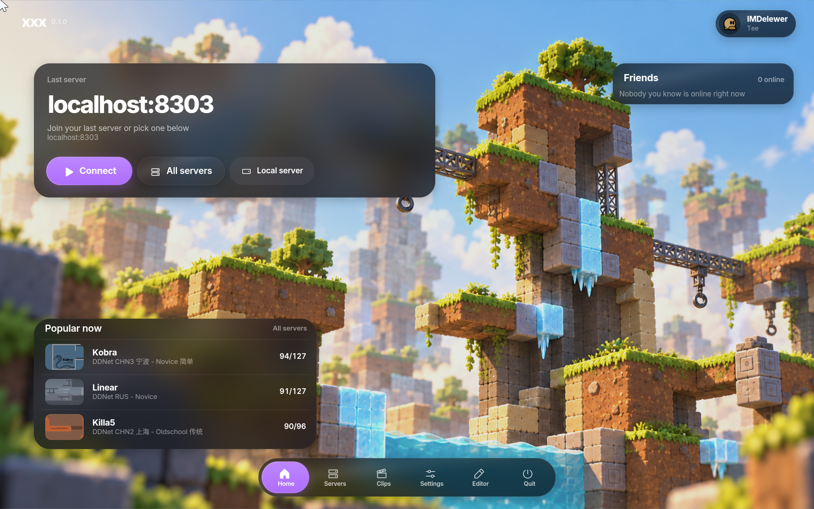

<div align="center">

**English** · [Русский](docs/ru/README.md)

A DDNet client with XUI, a Vulkan interface with glass panels and an editable HUD.

[](#download)
[](#requirements)
[](docs/BUILDING.md)
[](LICENSE)

[Download](#download) · [Build](docs/BUILDING.md) · [Port XUI](PROMT.md) · [Credits](licenses/README.md)



</div>

## Features

- **XUI menus** — home screen, server browser, player profiles and settings with a bottom dock.
- **Glass and themes** — dark and light modes, accent color, panel transparency, backdrop blur and a custom PNG background.
- **HUD editor** — draggable modules, alignment guides, a movable inspector, Tab to hide the panel, and Dynamic Island.
- **Resource catalog** — browse, preview, install and apply teedata entities, weapon textures, emoticons, particles, map tiles and skins.
- **Connection status** — map loading and download progress in the menu, using your selected accent.

Based on **DDNet 20.2.1**. Networking, physics, ordinary prediction, map rendering,
demos and the map editor remain DDNet. The public client excludes cheats,
input automation, spoofing, fake ping, trajectories, hitboxes and radar.

[Light theme](docs/screenshots/appearance-light.png) · [HUD editor](docs/screenshots/hud-editor.png) · [Resource catalog](docs/screenshots/catalog.png) · [About](docs/screenshots/about.png)

English, Russian and the standard UI fonts are included. Japanese, Korean and Chinese
fonts are an optional 29 MB download in Settings → General, fetched from a pinned
version of the official DDNet repository and verified before installation.

## Download

Packages are published to [GitHub Releases](https://github.com/IMDelewer/xxx-client/releases)
by the **Release** workflow. It builds Windows, macOS and Linux, then attaches
the packages and `SHA256SUMS` after all builds and checks pass. Release notes
contain only the matching version entry from [CHANGELOG.md](CHANGELOG.md).

To publish, run **Actions → Release → Run workflow**, or push a tag matching
`XXX_VERSION`, such as `0.2.1`. Development builds remain available under
**Actions → Desktop builds → Artifacts**.

| Target | Package | Notes |
| --- | --- | --- |
| Windows x64 | `.zip` | Extract and run `xxx.exe` |
| macOS | `.dmg` | macOS 12 or later; drag `xxx.app` to Applications |
| Linux | `.tar.xz` | Built for Ubuntu 24.04 system libraries; extract and run `./xxx` |

Android, iOS, web and other non-desktop versions have not been tested; no
packages are provided for them. This repository targets Windows, macOS and Linux.

Windows, macOS and Linux builds are checked by CI. Desktop interaction was
tested on macOS. macOS packages use an ad-hoc signature;
Apple notarization is not configured. DDNet's updater is disabled for this fork.

## Requirements

A 64-bit desktop OS and a GPU/driver supporting **Vulkan 1.1**. On macOS,
MoltenVK translates Vulkan to Metal and is included in the package. There is
no OpenGL fallback. Internet access is needed for the server list, profiles
and resource catalog.

Minimum RAM, CPU and VRAM have not been measured. Disable Liquid glass to
reduce GPU work. XUI is native C++20 code using the client renderer.

## Build

Install the [dependencies for your platform](docs/BUILDING.md), then:

```sh
cmake -S . -B build -DCMAKE_BUILD_TYPE=Release \
  -DCLIENT=ON -DSERVER=OFF -DTOOLS=OFF -DVULKAN=ON \
  -DVIDEORECORDER=OFF -DDDEV_XX=OFF -DINFORM_UPDATE=OFF
cmake --build build --target game-client --config Release --parallel
```

See [Building](docs/BUILDING.md) for packaging, Windows dependencies and dev builds.
Developer commands such as `xx_after`, `xx_screenshot` and `xx_dev_*` are available
only with `DDEV_XX=ON`. The regular `screenshot` command and F10 remain available.

## Source layout

| Directory | Contents |
| --- | --- |
| `src/game/client/xui/` | Layout, themes, widgets and screens |
| `src/game/client/components/menu_services/` | Menu data, HTTP, resources and native file dialogs |
| `src/game/client/components/xxx/` | Cosmetic components and Dynamic Island |
| `src/game/client/dev/` | Tools compiled only with `DDEV_XX` |
| `data/` | Runtime assets and translations |
| `docs/` | Build and contributor guides; Russian translations in `docs/ru/` |
| `licenses/` | Upstream licenses and third-party credits |

[Architecture](docs/architecture/README.md) · [Contributing](docs/CONTRIBUTING.md) · [XUI porting prompt](PROMT.md)

## Credits and license

xxx client and XUI are maintained by [IMDelewer](https://github.com/IMDelewer).
Thanks to DDNet, DDRace, Teeworlds, T-Client, and RoflikBEST with the BestProject
contributors. [Third-party credits and licenses](licenses/README.md) are preserved.

[LICENSE](LICENSE) contains the terms for original xxx source code
and the original XUI design. Reusing the protected design, including rebuilding
it from screenshots with different code, requires visible credit:

> Interface design based on **XUI (xxx client)**, by IMDelewer.

Please respect other people's work. Give XUI credit in your repository README
or in-game About page. We ask for the same acknowledgment if XUI inspired your
design; general ideas and independent designs remain outside our exclusive rights.
