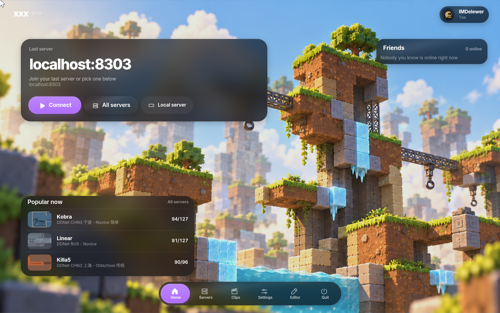

<div align="center">

[English](../../README.md) · **Русский**

DDNet с интерфейсом XUI: Vulkan, стеклянные панели и настраиваемый HUD.

[](#скачать)
[](#требования)
[](../BUILDING.md)
[](../../LICENSE)

[Скачать](#скачать) · [Сборка](BUILDING.md) · [Перенос XUI](../../PROMT.md) · [Авторы](THIRD_PARTY_NOTICES.md)



</div>

## Возможности

- **Меню XUI** — главный экран, браузер серверов, профили и настройки с нижним доком.
- **Стекло и темы** — светлая и тёмная темы, свой акцент, прозрачность панелей, размытие и PNG-фон.
- **Редактор HUD** — перетаскивание модулей, направляющие, перемещаемая панель, скрытие по Tab и Dynamic Island.
- **Каталог ресурсов** — поиск, превью, установка и применение энтити, оружия, эмоций, частиц, тайлов и скинов с teedata.
- **Подключение** — загрузка карты и прогресс скачивания в меню с выбранным акцентом.

Основа — **DDNet 20.2.1**. Сеть, физика, обычная prediction, рендер карт, демо
и редактор остаются DDNet. В публичной версии нет читов, автоматизации ввода,
спуфера, подмены пинга, траекторий, хитбоксов и радара.

[Светлая тема](../screenshots/appearance-light.png) · [Редактор HUD](../screenshots/hud-editor.png) · [Каталог](../screenshots/catalog.png) · [О клиенте](../screenshots/about.png)

## Скачать

Готовые сборки публикуются в [GitHub Releases](https://github.com/IMDelewer/xxx-client/releases)
через workflow **Release**. Он собирает Windows, macOS и Linux и добавляет
архивы с `SHA256SUMS` после успешной сборки и проверок всех платформ.

Для выпуска нажмите **Actions → Release → Run workflow** или отправьте тег,
совпадающий с `XXX_VERSION`, например `0.1.0`. Промежуточные сборки остаются
в **Actions → Desktop builds → Artifacts**.

| Платформа | Архив | Запуск |
| --- | --- | --- |
| Windows x64 | `.zip` | Распаковать и запустить `xxx.exe` |
| macOS | `.zip` с `xxx.app` | Архитектура и версия ОС зависят от библиотек; текущая локальная arm64-сборка требует macOS 26.0 |
| Linux | `.tar.xz` | Сборка под библиотеки Ubuntu 24.04; распаковать и запустить `./xxx` |

Android, iOS, web и прочие версии не тестировались; готовых сборок для них нет.
Этот репозиторий ориентирован на Windows, macOS и Linux.

Сборки Windows, macOS и Linux проверяются в CI. Работа интерфейса проверена
на macOS. Подпись macOS — ad-hoc, нотариализация Apple не настроена.
Обновление через сервер DDNet в этом форке отключено.

## Требования

64-разрядная desktop-ОС и GPU с драйвером **Vulkan 1.1**. На macOS используется
MoltenVK поверх Metal; библиотека входит в пакет. OpenGL fallback отсутствует.
Для списка серверов, статистики и каталога нужен интернет.

Минимальные RAM, CPU и VRAM пока не измерены. Для снижения нагрузки на GPU
можно отключить Liquid glass. XUI написан на C++20 и использует рендерер клиента.

## Сборка

Установите [зависимости своей платформы](BUILDING.md), затем:

```sh
cmake -S . -B build -DCMAKE_BUILD_TYPE=Release \
  -DCLIENT=ON -DSERVER=OFF -DTOOLS=OFF -DVULKAN=ON \
  -DVIDEORECORDER=OFF -DDDEV_XX=OFF -DINFORM_UPDATE=OFF
cmake --build build --target game-client --config Release --parallel
```

В [инструкции сборки](BUILDING.md) описаны упаковка и dev-сборка.
Команды `xx_after`, `xx_screenshot` и `xx_dev_*` доступны только при `DDEV_XX=ON`.
Обычная команда `screenshot` и F10 сохранены.

## Структура

| Каталог | Назначение |
| --- | --- |
| `src/game/client/xui/` | Компоновка, темы, виджеты и экраны |
| `src/game/client/components/menu_services/` | Данные меню, HTTP, ресурсы и выбор файлов |
| `src/game/client/components/xxx/` | Косметические компоненты и Dynamic Island |
| `src/game/client/dev/` | Инструменты под `DDEV_XX` |
| `data/` | Ресурсы и переводы |
| `docs/` | Документация; русский перевод в `docs/ru/` |
| `licenses/` | Лицензии upstream и благодарности |

[Архитектура](ARCHITECTURE.md) · [Участие в разработке](CONTRIBUTING.md) · [Промпт переноса XUI](../../PROMT.md)

## Авторы и лицензия

Автор xxx client и XUI — [IMDelewer](https://github.com/IMDelewer).
Спасибо разработчикам DDNet, DDRace, Teeworlds, T-Client, RoflikBEST и соавторам BestProject.
[Лицензии и авторство заимствованных частей](THIRD_PARTY_NOTICES.md) сохранены.

Мои условия для оригинального кода и дизайна собраны в [LICENSE](../../LICENSE).
Если воспроизводите охраняемый дизайн, в том числе по скриншотам на другом коде,
укажите источник:

> Дизайн интерфейса основан на **XUI (xxx client)**, автор IMDelewer.

Ребята, не будьте эгоистами и уважайте чужой труд. Напишите название интерфейса
хотя бы в README открытого репозитория или в игровом разделе «О клиенте».
При простом вдохновении мы тоже просим об упоминании; общие идеи и независимый
дизайн не становятся нашей исключительной собственностью.
